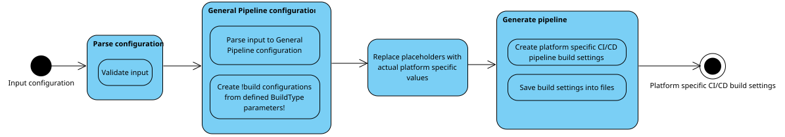

# fanCI compiler

Artifact of the paper *Universal CI/CD Process Configuration Language*.

fanCI is a platform-independent language for describing CI/CD process configurations. This repository
contains its compiler, which parses fanCI configurations (YAML) into an intermediate representation following
the formal model of the paper and generates platform-specific configurations for **TeamCity** (Kotlin DSL)
and **GitLab CI/CD** (`.gitlab-ci.yml`), together with the collection of example configurations and their
generated results.



## Contents

| Path | Content |
|---|---|
| `src/main/kotlin` | The compiler: `configurationModel` (input language), `pipeline` (intermediate representation), `generator` (TeamCity and GitLab CI/CD generators). |
| `src/test/kotlin` | Unit tests. |
| `example-configurations/configurations` | Example fanCI configurations, including the example of the paper. |
| `example-configurations/environments` | Environment file of the GitLab generator used for the examples. |
| `example-configurations/output` | Results of compiling the examples: `teamcity/` and `gitlab/`. |
| `generateExamples.sh` | Compiles the examples for both platforms. |
| `doc` | Reference of the input language and notes on the GitLab generator. |

## Requirements

- JDK 17 to 24 on `PATH` or in `JAVA_HOME`, to run Gradle. The Gradle wrapper (8.14.1) does not start on JDK 25.
- Internet access for the first build. The wrapper downloads Gradle, the libraries from Maven Central and,
  when no JDK 21 is installed, the JDK 21 toolchain the compiler is built with.

No CI/CD server is needed to compile the examples. A TeamCity or GitLab server is needed only to execute
the generated configurations.

## Compiling the example configurations

Build the compiler and run its tests:

```bash
./gradlew build
```

Compile all examples for both platforms:

```bash
./generateExamples.sh
```

The script runs the two commands below and rewrites `example-configurations/output`. The repository already
contains the expected results, so after the run `git status example-configurations/output` reports no change.

```bash
# TeamCity
./gradlew run --args="-c example-configurations/configurations -o example-configurations/output/teamcity -t teamcity -b false"

# GitLab CI/CD
./gradlew run --args="-c example-configurations/configurations -o example-configurations/output/gitlab -t gitlab -e example-configurations/environments/GitLabEnv.yaml -b false"
```

The compiler reads every `.yaml` file in the configuration directory, one component per file, and writes
one directory per component:

| Platform | Output of a component |
|---|---|
| TeamCity | `<Project>_<Component>/Project.kt`, `buildTypes/*.kt` (one file per build configuration), `vcsRoots/*.kt` |
| GitLab CI/CD | `_<Project>_<Component>/.gitlab-ci.yml` |

The directory of a configuration file is the project of its component: `Templates/service.yaml` defines
the component `::Templates::Service`, and a file in the root directory defines a component without a project,
such as `::comp`.

Messages expected during the compilation of the examples:

- `INFO: [A] Manual action required: Create a schedule in GitLab ...`. GitLab CI/CD has no time triggers in
  `.gitlab-ci.yml`. A pipeline schedule with the printed cron expression and variable has to be created on
  the server.
- `WARNING: ... Pull request support cannot reuse the VCS root credentials ...` (TeamCity). The examples access
  their repositories anonymously, so the generated pull request feature has no token to read pull requests with.

### Arguments

```bash
./gradlew run --args="--config-dir=<path> --output-dir=<path> --target-platform=<platform> [--platform-env-file=<path>] [--generate-diff=<path>]"
```

- **-c | --config-dir** `<path>`: Directory with the YAML configuration files. All files in it are compiled together, so dependencies between components are resolved.
- **-o | --output-dir** `<path>`: Directory for the generated configurations. It is created when missing and its previous content is replaced.
- **-t | --target-platform** `<platform>`: `TeamCity` or `GitLab` (case-insensitive).
- **-e | --platform-env-file** `<path>`: Platform environment file with the properties of the target server (runner tags, names of keys and connections), see [ManageSecrets.md](doc/ManageSecrets.md). Without it the values of the input configuration are used unchecked.
- **-d | --generate-diff** `<path>`: Writes a diff between the current content of `--output-dir` and the newly generated output into the given directory.
- **-b | --create-backup** `<bool>`: Backs up the current `--output-dir` before replacing it. Default: `true`.
- **-i | --ignore-invalid**: Skips invalid configurations with a warning instead of stopping at the first error.
- **--configuration** `<path>`: A single YAML configuration file, instead of `--config-dir`.
- **--help**: Prints the help message.

### Compiling your own configuration

Place the configuration into a new directory and compile that directory. For example, to compile only
the example of the paper:

```bash
mkdir my-configurations
cp example-configurations/configurations/comp.yaml my-configurations/
./gradlew run --args="-c my-configurations -o my-output/gitlab -t gitlab"
```

## Example configurations

Every example starts with a comment describing its build configurations, triggers and the behaviour to observe.

| Configuration | Shows | Paper |
|---|---|---|
| `comp.yaml` | The example of the paper, line by line: parameters, output and input artifacts, a dependency, a matrix, VCS and time triggers with arguments. | Section *Input Language*, the example figure |
| `parameters.yaml` | The two listings on parameter values: a parameter holding a shell command and parameters referencing other parameters. | Section *Input Language*, *Dealing with Parameters* |
| `parameter-command.yaml` | A parameter holding a command evaluated by the script. | Section *Input Language*, *Dealing with Parameters* |
| `ArtifactPaths/artifact-paths.yaml` | Which part of a source path is kept for output and input artifacts: files, directories, wildcards, hidden files, archives, and rules matching no file. | Section *Formal model*, *Artifacts* |
| `ReverseDependencyTree/shared-triggers.yaml` | Several VCS triggers at different levels of a dependency tree matching the same event: which build jobs are created and which trigger arguments the shared dependency receives. | Section *Formal model*, *Triggers*; *Evaluation* |
| `Project/ComponentA.yaml`, `Project/SubProject/ComponentB.yaml` | A dependency between build configurations of two components, with artifacts and a parameter set through the dependency. | Section *Platform Configuration Generation* |
| `Templates/service.yaml` | Predefined build configurations: CMake, Docker build and push, kubectl, semantic-release. | Section *Predefined CI/CD Configurations* |
| `Templates/library.yaml` | Predefined build configurations: Python package (pytest) and publishing to PyPI. | Section *Predefined CI/CD Configurations* |

The repository addresses, image registries and tokens in the examples are placeholders. To execute a generated
configuration, set `repository` to a repository of your own and, for a private repository, add
`vcs-auth-method` ([Component.md](doc/Component.md)). The GitLab runner tags are set in
`example-configurations/environments/GitLabEnv.yaml`.

## From the paper to the implementation

| Formal model | Input language | Implementation |
|---|---|---|
| Component | `component`: `name`, `repository`, `default-branch` | `configurationModel/InputConfiguration.kt`, `pipeline/PipelineSettings.kt` |
| Build configuration | item of `build-configurations`: `configuration-name`, `type` | `configurationModel/BuildConfigurationDefinition.kt`, `pipeline/IBuildConfiguration.kt` |
| Build script and its container | `steps` (`step-name`, `script-content`), `docker-image` | `pipeline/BuildStep.kt` |
| Dependencies and failure modes | `dependencies`: `build-configuration-name`, `failure-action` | `pipeline/Dependency.kt`, `generator/DependencyManager.kt` (acyclicity check) |
| Input artifacts | `dependencies[].artifacts`: `source`, `destination` | `pipeline/Artifact.kt` |
| Output artifacts | `publish-artifacts`: `source`, `destination` | `pipeline/Artifact.kt` |
| Parameters and default values | `parameters`: `name`, `value` | `pipeline/Parameter.kt` |
| Matrix | `matrix` | `IBuildConfiguration.buildMatrix` |
| VCS trigger | `triggers` of `type: vcs`: `watched-component`, `include-branches`, `exclude-branches`, `include-paths`, `exclude-paths`, `parameters` | `pipeline/Trigger.kt` |
| Time trigger | `triggers` of `type: schedule`: `cron`, `include-branches`, `parameters` | `pipeline/Trigger.kt` |
| Reading and setting parameter values | `%fanciGetParam(name)%`, `%fanciSetParam(name, value)%` | `generator/ParameterReplacer.kt` |
| Build configuration templates | `type` and its input fields | `configurationModel/buildTypeDefinitions`, `pipeline/buildConfiguration` |
| Platform generators | | `generator/platforms/teamcity`, `generator/platforms/gitlab` |

The standard parameters are mapped by the generators to the parameters of the platforms:

| fanCI | TeamCity | GitLab CI/CD |
|---|---|---|
| `FANCI_BUILD_BRANCH` | `teamcity.build.branch` | `CI_COMMIT_REF_NAME` |
| `FANCI_DEFAULT_BRANCH` | `vcsroot.branch` | `CI_DEFAULT_BRANCH` |
| `FANCI_BUILD_NUMBER` | `build.number` | `CI_PIPELINE_ID` |
| `FANCI_BUILD_COUNTER` | `build.counter` | `CI_PIPELINE_ID` |
| `FANCI_COMPONENT_URL` | `vcsroot.url` | `CI_REPOSITORY_URL` |
| `FANCI_CHECKOUT_DIR` | `teamcity.build.checkoutDir` | `CI_PROJECT_DIR` |

## Input language reference

A configuration file defines one component:

```yaml
component:
  name: "::Project::Component"   # Fully qualified name; the projects follow the directories of the file
  repository: "https://example.com/org/component.git"
  default-branch: main            # Optional, default main
  vcs-auth-method:                # Optional, see doc/Component.md
    type: <vcs-auth-method-type>
  submodule-strategy: none        # Optional: recursive, shallow, none (default)
  pull-request:                   # Optional, pull requests are built by default, see doc/PullRequests.md
    enabled: true
  build-configurations:
    - type: "<BuildType>"         # ScriptRunner or a predefined build type
      # Fields of the build type
      dependencies: []            # Optional, see doc/BuildChaining.md
      triggers: []                # Optional, see doc/Triggers.md
      docker-image: ""            # Optional, image the build steps are executed in
      docker-connections: []      # Optional, IDs of Docker registry connections
      free-disk-space-gb: 0       # Optional, free disk space required by the build
```

All keys are written in kebab-case.

- [Component.md](doc/Component.md): the component and the authentication to its repository.
- [BuildTypes.md](doc/BuildTypes.md): common fields, `ScriptRunner`, `Composite`, and the predefined build types
  (CMake, Go, Python, PyPI, Docker, kubectl, semantic-release).
- [BuildChaining.md](doc/BuildChaining.md): dependencies, artifacts, and fully qualified names across components.
- [Parameters.md](doc/Parameters.md): parameters and the `%fanciGetParam(...)%` and `%fanciSetParam(...)%` notation.
- [Triggers.md](doc/Triggers.md): VCS and time triggers.
- [PullRequests.md](doc/PullRequests.md): building of pull requests.
- [ManageSecrets.md](doc/ManageSecrets.md): secrets and the platform environment files.
- [GitLabImplementation.md](doc/GitLabImplementation.md): mapping of the model to GitLab CI/CD and its limitations.

## Executing the generated configurations

- **GitLab CI/CD**: the generated `.gitlab-ci.yml` belongs to the root of the repository of its component.
  The runners must provide the tags of the environment file. Every time trigger needs a pipeline schedule
  created on the server with the cron expression, target branch and variable printed by the compiler.
- **TeamCity**: the generated directories are Kotlin DSL sources of TeamCity projects, to be stored as
  versioned settings of the server. SSH keys, tokens and Docker registry connections referenced by
  the configurations must exist on the server under the same names.

## License

GNU Lesser General Public License v3.0, see [LICENSE](LICENSE).
