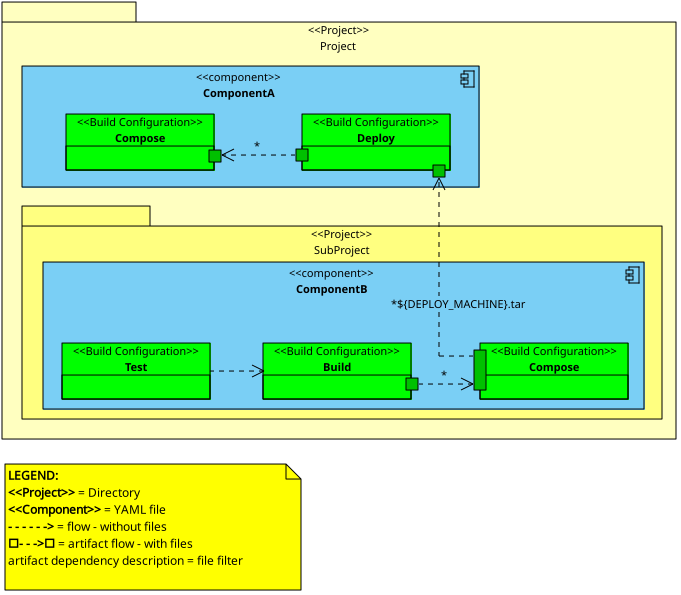

# Build Chaining

Build chaining enables one build configuration depend on others, either within the same component or across components. It serves for build-once/use-many, multi-step orchestration, composition of artifacts, and a single entry point for parameters that flow through the chain.

> NOTE: All examples in the document are in context of [example/buildChain](../example/buildChain) configuration directory.

## Why chain builds?

- Reuse: Consume outputs of existing builds without duplicating logic.
- Orchestration: Compose multi-step processes across components.
- Single UX: Trigger once, set inputs once, observe all downstream results and artifacts.

---

## Concepts

- Project: Top-level container; projects can be nested.
- Component: A repository (application, library, interface) that hosts build configurations.
- Build Configuration: A runnable pipeline unit (build, test, package, deploy, etc.).
- Fully Qualified Name (FQN): Full path to a project/build/parameter.
  - Uses `::` as a separator.
  - Starts from the Root project with a leading `::`. 
  - Pattern:
    - Build: `::[<Project>::...]<Component>::<Build>`
    - Parameter: `::[<Project>::...]<Component>::<Build>::<Parameter>`
  - Examples:
    - Build: `::Project::SubProject::ComponentB::Composite`
    - Parameter: `::Project::ComponentA::Deploy::DEPLOY_MACHINE`

---

## How chaining works

- A build configuration declares dependencies on other build configurations.
- This build configuration is then referred to as *the orchestrating build*
- During execution, the orchestrating build:
  - Triggers dependencies
  - Waits for dependencies builds and reacts to their status (fail/cancel/ignore).
  - Can consume their artifacts.
  - Can read or override their input parameters via FQN.

The orchestrating build is the build configuration that declares the dependencies.
While any build can orchestrate, the `Composite` build configuration type is the recommended type for top-level orchestration.

---

## Project structure example

This is an example of how the directory structure maps to FQN:

**Directory structure**:
```
Project
├── ComponentA.yaml
└── SubProject
    └── ComponentB.yaml
```

**Fully Qualified Names**:
- ::Project
  - ::Project::Component A
      - ::Project::Component A::Composite
      - ::Project::Component A::Deploy
        - ::Project::Component A::Deploy::DEPLOY_MACHINE
        - ::Project::Component A::Deploy::DEPLOY_ADDRESS
  - ::Project::SubProject::Component B
    - ::Project::SubProject::Component B::Test
    - ::Project::SubProject::Component B::Build
    - ::Project::SubProject::Component B::Composite

Diagram with dependencies:



Note: This diagram shows also dependency flow. This will be explained in the next section.
---

## Configuration of a build chain

### a) Component-internal chaining (same component)

Use a relative build name to depend on another build within the same component. The system resolves it against the current project path.

- When to use: The dependency is in the same project/component.
> Note: Serves for shortening the dependency name. Is equivalent to using FQN

Example (relative dependency name):
```yaml
# In Project/SubProject/ComponentB.yaml in GoPackage build type
dependencies:
- build-configuration-name: "Go Test" # resolved as ::Project::SubProject::ComponentB::Go Test 
  failure-action: FAIL  # Failure behaviour is described in a section below
```

### b) Cross-component chaining (different component)

Use a Fully Qualified Name to depend on a build in another component.

- When to use: The dependency lives in a different project/component.
- Pros: Explicit, unambiguous; safe across project boundaries.

Example (FQN dependency):
```yaml 
# In Project/ComponentA.yaml in ScriptRunner Deploy Project 
dependencies:
  - build-configuration-name: ::Project::SubProject::ComponentB::Composite
    failure-action: FAIL
    # artifacts are described in a section below
```

Notes:
- FQN is validated against available build configurations.

---

## Failure behavior

For each dependency, set how the orchestrating build should react if it fails or is cancelled:

- IGNORE: Continue as if no error happened.
- ADD_PROBLEM: Mark a problem but continue (for warning-like scenarios).
- FAIL: Fail current build.
- CANCEL: Cancel current build.

Pick the strictest policy that matches downstream criticality.

---

## Artifact flow

Each build configuration can publish artifacts.
The artifacts can be consumed by downstream builds.
The orchestrating build sets dependencies and defines which artifacts to copy.
- Can define the destination where to copy the artifacts (root directory by default).
- Can use wildcards (`*`/`**`) to define multiple files from the source.
- Recommended to use destination subfolders per dependency to avoid collisions when composing outputs.

Example:
```yaml 
dependencies:
  - build-configuration-name: "Go Package"
    failure-action: ADD_PROBLEM
    artifacts:
      - source: "*"
        destination: "package/"
  - build-configuration-name: "Go Test"
    failure-action: ADD_PROBLEM
    artifacts:
      - source: "test-results.xml"
        destination: "test-results/"
```

### Artifact path

Supports using wildcards to specify source files, e.g., `*.zip`, `**/*.txt`.
* [Examples of wildcards usage](https://www.jetbrains.com/help/teamcity/wildcards.html#Antlike+Wildcards)

Supports using package paths: `package.zip!path/to/file-in-package.txt`
* Package paths are defined by exclamation mark '!' character.
* Supported packages are zip, 7zip, jar, tar, and tar.gz.
* This will extract defined files to the destination folder.

---

## Parameter flow

- Get parameter from dependency using FQN:
  - Use `%pipelineGetParam(<FQN>)%` clause
  - Example: `%pipelineGetParam(::Project::ComponentA::Deploy Project::DEPLOY_ADDRESS)%`
- Override dependency input parameter before triggering the chain (in parameters or trigger sections):
    - Define the parameter name with FQN to pre-set values downstream.
    - Example:
      - ```kotlin
        # In Project/ComponentA.yaml in Composite build type, overriding DEPLOY_ADDRESS in 'Deploy Project' build step
        parameters:
          - name: ::Project::ComponentA::Deploy Project::DEPLOY_ADDRESS
            value: 192.168.1.90
    ```

See [Parameters.md](Parameters.md) for syntax and platform specifics.

Guidelines:
- Use local parameter names for same-build usage.
- Use FQNs when reading or overriding across builds/components.
- Centralise user-facing inputs at the composite build; pass them down via overrides.

---

## Best practices

- Use [Composite](BuildTypes.md#composite) to aggregate outputs of a component and the component chain.
- Keep components owned and versioned independently; chain via FQN for clarity.
- Standardise artifact layouts to simplify composition.
  - Project shall follow company policies and standardisation for library, application, ...
- Keep failure policies explicit and consistent across the chain.
