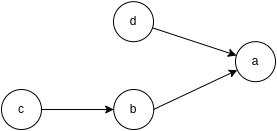

# Formal model

This chapter describes the formal model of a platform-independent CI/CD
pipeline. The model defines the purpose and behaviour of the elements of
the pipeline.

## Core concepts

This section introduces the core concepts of the formal model at an
informal level. The purpose is to establish a shared terminology for
CI/CD pipelines before the concepts are defined precisely in the
subsequent sections.

Pipeline

:   is a finite collection of related build configurations forming a
complete CI/CD process specification.

Component

:   is tied to a *version control system* (VCS) repository. The
repository is an input for each build configuration in the
component's pipeline. For example, a component can be an application
or a library.

CI/CD build process

:   is a comprehensive process relevant to a component, such as build,
test, or deploy.

Build configuration

:   specifies an atomic CI/CD build process by grouping a set of build
steps and defining its inputs, outputs, triggers, dependencies, and
environment.

Dependency

:   defines a relation between build configurations

Build step

:   is an atomic unit of work within a build configuration.

Artifact

:   is a file produced or consumed by build configurations.

Parameter

:   is a named value that configures the behaviour of a build
configuration.

Trigger

:   is a rule that starts a build configuration in response to events.

Build job

:   is an execution instance of a build configuration, with concrete
inputs that produce concrete outputs.

##### Notation.

Throughout this chapter, the following sets are used with a fixed meaning:
-   $\mathit{BC}$ denotes the set of all build configurations,
-   $\mathit{Paths}$ denotes the set of all possible paths to filesystem
    objects (files and directories) in a component's repository checkout
    directory,
-   $\mathcal{RB}$ denotes the set of all VCS repository branches,
-   $\mathit{N}$ denotes the set of all valid parameter names,
-   $\mathit{V}$ denotes the set of all valid parameter values.

## Build configuration 

A *build configuration* is a specification of an atomic CI/CD build
process for a component within a pipeline. It groups related build
steps, inputs, outputs, environment settings, triggers, and dependencies
into a single, cohesive unit, enabling reproducible and well-defined
build processes.

The subsections of this section define the mentioned elements. The
formal definition of build configuration is introduced in
Subsection [1.2.7](#sec:formalBuildConfiguration).

Each build configuration is associated with exactly one component and
operates by executing its build steps within the context of the
component's VCS repository checkout, which forms an implicit,
foundational input. This repository checkout directory serves as the
root workspace for all relative file paths, defined by the set
$\mathit{Paths}$, referenced within the build configuration.

Build configuration defines the environment, which defines contextual
parameters (e.g., connections to external services, disk space) that
ensure a consistent execution context isolated from external influences.
While the environment affects the runtime behaviour, it does not alter
the logical dependencies or data flow between build steps. The concrete
environment setting is further described in
Section [\[sec:environmentSettings\]](#sec:environmentSettings).

### Build step

A *build step* $S$ is an atomic unit of work in a build configuration, defined as a tuple:
$$S = \bigl(
id,\
\mathit{script},\
\mathit{container},\
\mathit{workDir},\
\mathit{conditions}
\bigr)$$ 
where
-   $\mathit{id}$ is the name of the build step,
-   $\mathit{script}$ is a string containing the concrete program to
    transform inputs into outputs,
-   $\mathit{container}$ defines an isolated, reproducible execution
    environment,
-   $\mathit{workDir} \in \mathit{Paths}$ is the working directory, in
    which the $\mathit{script}$ is executed,
-   $\mathit{conditions}$ is a finite set of run conditions determining
    if the step $S$ is executed.

#### Run conditions

Run conditions restrict the execution of build steps based on parameter
values. They are evaluated in the context of a concrete build job. Let
$\mathit{Params}(x)$ be the set of parameters associated with build
configuration $x$ (see
Section [1.2.2](#sec:parameters)). Each parameter $P \in \mathit{Params}(x)$
is a triple $P = (n, v_P)$ where $n$ is the parameter name, $v_P$ is its
value.

A *run condition* for a build step $S$ in build configuration $x$ is a triple: 
$$c = (n, v, op)$$ 
where
-   $n \in \mathit{N}_x$ is the name of a parameter defined by build
    configuration $x \in \mathit{BC}$,
-   $v \in \mathit{V}$ is a comparison value,
-   $op \in \{\mathsf{Equal}, \mathsf{NotEqual}, \mathsf{Contain}, \mathsf{NotContain}\}$
    is a comparison operator.

Let the parameter value of $n$ be $Params(x)(n) = v_P$. The condition
$c = (n, v, op)$ is *satisfied* if and only if the predicate $op$ holds
for the pair of values $(v_P, v)$, i.e., if
$$op(v_P, v) = \mathsf{true}$$

Each build step $S$ is associated with a finite set of run conditions
$\mathit{Cond}(S)$. All conditions are interpreted conjunctively. The
build step $S$ is eligible for execution if and only if every condition
$c \in \mathit{Cond}(S)$ is satisfied.

#### Build steps of a build configuration

Let $\mathit{Steps}(x)$ denote the finite linearly ordered sequence of
build steps belonging to build configuration $x$:
$$\mathit{Steps}(x) = [ S_1, S_2,\ldots, S_n ]$$

The build steps of $x$ are executed in the order specified by this
sequence, subject to their run conditions.

### Parameters

A *parameter* is a named value, defined by a build configuration. The
parameters can be used to define input values or to pass values for
later use. For each build configuration $x \in \mathit{BC}$, let
$\mathit{N}_x \subseteq \mathit{N}$ be the finite set of parameter names
defined by $x$. The parameters of $x$ are given by a partial function
$$\mathit{Params}(x) : \mathit{N}_x \rightharpoonup \mathit{V},$$ which
maps each parameter name $n \in \mathit{N}_x$ to its current value
$v \in \mathit{V}$. The arrow $\rightharpoonup$ marks a partial function
Since parameter names form the domain $\mathit{N}_x$ of the function
$\mathit{Params}(x)$, they are unique within each build configuration
$x$.

Informally, for $n \in \mathit{N}_x$ with $\mathit{Params}(x)(n) = v$,
we may view the corresponding parameter as the pair $$(n,v)$$ and the
set of all parameters defined by $x$ as
$$\{\, (n,v) \mid n \in \mathit{N}_x,\ \mathit{Params}(x)(n) = v \,\}$$

Each parameter of $x$ therefore, consists of
-   a unique and immutable *name* $n \in \mathit{N}_x$, used for
    referencing,
-   a *value* $v \in \mathit{V}$.

Assigning a new value $v' \in \mathit{V}$ to a parameter name
$n \in \mathit{N}_x$ with $\mathit{Params}(x)(n) = v$ is modelled by the
update $$\mathit{Params}(x)(n) := v'$$

#### Reference mechanism

To work with a parameter value, the parameter can be referenced by the
partial function:
$$\mathit{Ref} : \mathit{BC} \times \mathit{N} \rightharpoonup \mathit{V}$$
by 
$$\mathit{Ref}(x,n) =
\begin{cases}
\mathit{Params}(x)(n) & \text{if } n \in \mathit{N}_x,\\
\text{undefined}       & \text{otherwise.}
\end{cases}$$ 
A parameter owned by a build configuration $x \in BC$ with
name $n \in N_x$ is referenced by the pair $(x,n)$ and its value is
obtained as $\mathit{Ref}(x,n)$. This referencing scheme provides clear
contextual unambiguity when accessing parameter values across build
configurations.

### Build matrix

A *build matrix* for build configuration $x$, denoted $\mathit{BM}(x)$,
is a finite set of matrix parameters:
$$\mathit{BM}(x) = \{\mathit{MP}_1, \ldots, \mathit{MP}_k\}$$
where each *matrix parameter* $\mathit{MP}_i$ is a named parameter. 
Formally, a matrix parameter $\mathit{MP}$ is a pair:
$$\mathit{MP} = (n, \mathit{Vals})$$
where
-   $n \in N$ is the unique name of the parameter,
-   $\mathit{Vals} \subseteq V$ is a non-empty finite set of permissible
    values that the parameter takes.

Let $M_x$ denote the set of matrix parameter names in $\mathit{BM}(x)$:
$$M_x = \{n_1, \dots, n_k\}$$ where each matrix parameter name $n_i$ has
an associated set of values $\mathit{Vals}(n_i) = \mathit{Vals}_i$.

Matrix parameter names are distinct from the parameter names defined by
the build configuration, i.e. $M_x \cap N_x = \emptyset$.

#### Build job instantiation

Starting a build configuration $x$ with a defined build matrix
$\mathit{BM}(x)$ creates one build job for each distinct assignment of
values to the matrix parameter names.

For each build configuration $x$ with matrix parameter names $M_x$, the
set of all matrix assignments is
$$\mathit{Matrix}(x) = \left\{\, m : M_x \to \mathit{V} \;\mid\;
\forall n \in M_x,\ m(n) \in \mathit{Vals}(n) \,\right\}.$$ Each
assignment $m \in \mathit{Matrix}(x)$ is a mapping
$m(n) \in \mathit{Vals}(n)$ that assigns one of its permissible values
to every $n \in N_x$.

For each $m \in \mathit{Matrix}(x)$:
-   A new build job $J = (x, b, m)$ is created, where $x$ is the build
    configuration, $b$ is the work branch, and $m$ is the matrix
    parameter assignment.
-   For every matrix parameter $n \in M_x$, the build job receives an
    input parameter $(n, m(n))$.

In summary, each build job is created with its own set of matrix
parameter values as input. All matrix input parameters are accessible
only to the build steps in this build job and cannot be used outside the
execution scope of the build job.

#### Example: Two-dimensional build matrix

Suppose the build configuration $x$ defines the following matrix parameters:
-   $\bigl(\texttt{OS},\ \{\texttt{Linux},\ \texttt{Windows}\}\bigr)$
-   $\bigl(\texttt{Arch},\ \{\texttt{x86},\ \texttt{x64},\ \texttt{arm}\}\bigr)$

then $M_x = \{\texttt{OS}, \texttt{Arch}\}$.

The set of all matrix parameter assignments is: $$\begin{aligned}
\mathit{Matrix}(x) = \{\, m : M_x \to \mathit{V} \mid\ &
m(\texttt{OS}) \in \mathit{Vals}(\texttt{OS}),\\
& m(\texttt{Arch}) \in \mathit{Vals}(\texttt{Arch}) \,\}.
\end{aligned}$$

The number of all such assignments is:
$$|\mathit{Vals}(\texttt{OS})| \times |\mathit{Vals}(\texttt{Arch})| = 2 \times 3 = 6$$
Therefore, when the build configuration $x$ is started, six distinct
build jobs are created, each corresponding to one mapping $m$.

```
---------------------
 m(OS)       m(Arch)
---------------------
 Linux       x86
 Linux       x64
 Linux       arm
 Windows     x86
 Windows     x64
 Windows     arm
---------------------
 Rows represent matrix parameter mapping for a build job.
```


Each row in the Table [1.1](#table:matrix) specifies a unique mapping $m$, passed to a
build job. For example, passing the mapping $m$ with
$m(\texttt{OS}) = \texttt{Windows}$ and
$m(\texttt{Arch}) = \texttt{arm}$ creates a build job that is supplied
with input parameters $(\texttt{OS}, \texttt{Windows})$ and
$(\texttt{Arch}, \texttt{arm})$.

Each build job executes with these parameter values as read-only inputs
within its execution context.

### Dependency

A *dependency* defines a constraint between two build configurations.

Dependency is defined as a binary relation:
$$\mathit{Dep} \ \subseteq BC \times BC$$
such that $\mathit{Dep}(a, b)$
holds if and only if build configuration $b$ **depends on** build
configuration $a$. This can also be read as $a$ **is a dependency** of
$b$.

The dependency relation induces a strict partial order on build
configurations, denoted by $\prec$. The relation $a \prec b$ holds if
and only if $b$ depends on $a$, either directly or transitively.

The relation $\prec$ is a strict partial order.
-   *Irreflexivity*: $\forall a \in BC,\; \neg (a \prec a)$
-   *Transitivity*: $\forall a, b, c \in BC,\; (c \prec b \wedge b \prec a) \implies c \prec a$

The strict partial order $\prec$ prescribes the permissible sequences of
execution of build configurations. Specifically, if $a \prec b$, then
$a$ must be executed before $b$.

A build configuration can consume the outputs (published artifacts) of
its dependencies.

#### Dependency chain

The dependencies of a build configuration create a *dependency chain*.
Let $\mathit{DC}(x) = \{ a \in BC \mid a \prec x \} \cup \{ x \}$ denote
the *dependency chain* of build configuration $x$. On $\mathit{DC}(x)$,
the relation $\prec$ induces a partially ordered set
$(\mathit{DC}(x), \prec)$ in which $x$ is the greatest element, i.e.
$$\forall a \in \mathit{DC}(x) \setminus \{ x \}:\ a \prec x.$$
The partial order on $\mathit{DC}(x)$ can be depicted using a *Hasse
diagram*, which graphically represents the build configurations as nodes
and the direct dependency relations as edges. The edges point toward the
greater element by convention.

Example: Let $BC = \{a, b, c, d\}$ be the set of build configurations
and $D = \{b \prec a,\, c \prec b,\, d \prec a\}$ denote the set of
direct dependency relations. In this example, the dependency chain of
build configuration $a$ is formed by all elements $x \in BC$ such that
$x \prec a$, together with $a$ itself. This example is illustrated by
the Hasse diagram below.

<figure id="img:exampleDependencyChain">

<figcaption>Example dependency chain as a Hasse diagram.</figcaption>
</figure>

#### Build order

Starting a build configuration $a$ always starts all build
configurations in the dependency chain $\mathit{DC}(a)$. The originally
started build configuration $a$ is the greatest element of the
dependency chain.

The partial order $(\mathit{DC}(a), \prec)$ can be extended to a linear
order (Szpilrajn extension theorem [@Szpilrajn1930]). The resulting
linear extension of the dependency chain describes the order of
execution of the build configurations, where the greatest build
configuration is started last.

In dependency relation $a \prec b$, the build configuration $b$ can
start only after $a$ has run to completion.

Let $a, b, c \in BC$ be build configurations with dependencies
$b \prec a$ and $c \prec b$. Starting build configuration $a$ also
starts build configurations $b$ and $c$. The order of execution is
$c \rightarrow b \rightarrow a$.

### Artifacts

An *artifact* is a file produced by a build job and made available for
subsequent use by other build jobs or by a user. The artifacts are
stored in an artifact repository.

#### Publish artifacts

The *publish artifacts* describe the *output* files of a build
configuration $x$. A publish artifact defines a path to a file that will
be saved to an artifact repository when a build job of $x$ finishes.
Formally defined as:
$$\mathit{PA}(x) \subseteq \mathit{Paths} \times \mathit{Paths}$$
where each pair $(s,d) \in \mathit{PA}(x)$ consists of
-   $s \in \mathit{Paths}$ is a source path in the working directory,
-   $d \in \mathit{Paths}$ is a destination directory path in the
    artifact repository.

Upon completion of a build job of $x$, for each publish artifact
$(s,d) \in \mathit{PA(x)}$, the files at a source path $s$ are
recursively copied to the artifact repository in the destination path
$d$. These artifacts are then available for further use. The full source
path is preserved.

Upon completion of a build job of $x$, for each publish artifact
$(s,d) \in \mathit{PA}(x)$, the files at source path $s$ are recursively
copied to the artifact repository under destination directory $d$.

#### Dependency artifacts

The *dependency artifacts* of a build configuration $x$, denoted
$\mathit{DA}(x)$, describe the *input* files that $x$ consumes from
other build configurations.

For each build configuration $a \in BC$ such that $a \prec x$, the
configuration $x$ may specify a finite set of dependency artifacts
$$A_a \subseteq \mathit{Paths} \times \mathit{Paths},$$
where each $(s,d) \in A_a$ refers to a file previously published by $a$ and
describes how this file is made available to $x$.

If $a$ publishes an artifact $(s',d') \in \mathit{PA}(a)$, then the
published files are stored in the artifact repository under path
$d'/s'$. A dependency artifact may reference this location as its source
path $s$, and specify a destination path $d$ in the working directory of
$x$.

The set of all dependency artifacts of $x$ is
$$\mathit{DA}(x) = \{\, A_a \mid a \in BC,\ a \prec x \,\}.$$

When a build job of $x$ starts, for each $A_a \in \mathit{DA}(x)$ and
each $(s,d) \in A_a$, the files published by $a$ and reachable under
path $s$ are recursively copied into the working directory of $x$ at
destination path $d$.

### Triggers

A *trigger* for build configuration $x$, denoted $\mathit{Trig}(x)$, is
a rule that is activated ("fired") in response to specific events.
Firing a trigger $\mathit{Trig}(x)$ causes the build configuration $x$
to be started.

A trigger is defined as a triple: $$\mathit{Trig}(x) = \bigl(
\mathit{WB},\
\mathit{Args}
\bigr)$$
where
-   $\mathit{WB}$ is a set of *work branches* $\mathit{WB} \subseteq \mathcal{RB}$,
-   $\mathit{Args}$ is a set of *parameters* supplied to $x$ when the trigger fires.

Each $(n, v) \in \mathit{Args}$ updates the value of a parameter
$\mathit{Params}(x)(n) := v$ for the execution context. The exact
interpretation of work branches is specific to the type of trigger. The
trigger types are described below in this subsection.

#### Version control system triggers

A *version control system* (VCS) *trigger*
$\mathit{Trig}^{\mathit{vcs}}(x)$ observes the changes in a VCS
repository and starts the build configuration $x$ when a matching change
is detected.

A VCS trigger is a triple: 
$$\mathit{Trig}^{\mathit{vcs}}(x) = \bigl(
\mathit{WB},\
\mathit{Params},\
\mathit{rules}
\bigr)$$ 
where
-   $\mathit{WB}$ is a set of work branches,
-   $\mathit{Args}$ is a parameter set,
-   $\mathit{rules}$ is a finite set of *trigger rules*.

Each trigger rule $r \in \mathit{rules}$ is a pair
$$r = \bigl(
\mathit{comp},\
\mathit{paths}
\bigr)$$ 
where
-   $\mathit{comp}$ is a component defining the VCS repository to
    monitor,
-   $\mathit{paths} \subseteq \mathit{Paths}$ limits watched changes to
    only these paths in the $\mathit{comp}$ repository.

Work branches $\mathit{WB}$ filter the branches that are watched for
changes.

#### Finish build triggers

A *finish build trigger* $\mathit{Trig}^{\mathit{fb}}(x)$ is a triple:
$$\mathit{Trig}^{\mathit{fb}}(x) = \bigl(
\mathit{WB},\
\mathit{Params},\
y
\bigr)$$
where
-   $\mathit{WB}$ is a set of work branches,
-   $\mathit{Params}$ is a parameter set,
-   $y \in BC$ is the build configuration whose run completion on branch
    $b \in \mathit{WB}$ fires the trigger.

#### Schedule triggers

A *schedule trigger* $\mathit{Trig}^{\mathit{sch}}(x)$ is defined by a triple 
$$\mathit{Trig}^{\mathit{sch}}(x) = \bigl(
\mathit{WB},\
\mathit{Params},\
\mathit{Schedule}\
\bigr)$$
where

-   $\mathit{WB}$ is a set of work branches,
-   $\mathit{Params}$ is the parameter set,
-   $\mathit{Schedule} \subseteq \mathcal{T}$ is the set of scheduled
    times at which the trigger will execute.

The set $\mathcal{T}$ denotes the domain of all possible time points.

Work branches define all branches for which the build configuration is
started when the schedule trigger fires.

### Formal definition of build configuration

Formally, a build configuration $x$ is a tuple: 
$$x = \bigl(
\mathit{Steps},\
\mathit{DA}(x),\
\mathit{PA}(x),\
\mathit{Params}(x),\
\mathit{BM}(x),\
\mathit{Trigs}(x),\
\mathit{DC}(x)
\bigr)$$
where

-   $\mathit{Steps}$ is a finite, linearly ordered sequence of build
    steps (Section [1.2.1](#sec:buildSteps)),
-   $\mathit{DA}(x)$ is a set of dependency artifacts
    (Section [1.2.5](#sec:artifacts)) which defines additional explicit inputs
    of a build configuration,
-   $\mathit{PA}(x)$ is a set of publish artifacts
    (Section [1.2.5](#sec:artifacts){reference-type="ref"
    reference="sec:artifacts"}),
-   $\mathit{Params}(x)$ is a parameter set associated with $x$
    (Section [1.2.2](#sec:parameters)),
-   $\mathit{BM}(x)$ is a build matrix of $x$
    (Section [1.2.3](#sec:buildMatrix)),
-   $\mathit{Trigs}(x)$ is a set of triggers that start $x$, the set is
    a union of all defined trigger types
    $\mathit{Trigs}(x) = \mathit{Trigs}^{VCS}(x) \cup \mathit{Trigs}^{fb}(x) \cup \mathit{Trigs}^{sch}(x)$(Section [1.2.6](#sec:triggers)),
-   $\mathit{DC}(x)$ is a dependency chain of $x$
    (Section [1.2.4](#sec:dependency)).

## Execution

Starting a build configuration creates a *build job*.

A *build job* $J$ is an instance of build configuration execution on a
specific branch of the component's VCS repository, with a concrete
assignment of parameter values.

For a build configuration $x$, let $\mathit{BM}(x)$ be its build matrix
defined in Section [1.2.3](#sec:buildMatrix) with matrix parameter names $M_x$. A build
job $J$ on branch $b \in \mathcal{RB}$ with matrix parameter assignment
$m$ is defined as a triple: $$J = (x, b, m)$$ where

-   $x \in \mathit{BC}$ is the executed build configuration,
-   $b \in \mathcal{RB}$ is the repository checkout branch,
-   $m : N \to V$ is a mapping from matrix parameter names $n \in M_x$
    to values $v \in V$, such that $m(n) \in \mathit{Vals}(n)$ as
    specified in the matrix parameter definition in
    Section [1.2.3](#sec:buildMatrix).

For the duration of a build job of $x$ with matrix assignment $m$, the
parameter function is extended to
$$Params_J(x) : N_x \cup M_x \rightharpoonup V$$
defined as
$$Params_J(x)(n) =
\begin{cases}  
m(n) & \text{if } n \in M_x, \\
Params(x)(n)        & \text{if } n \in N_x.
\end{cases}$$

The build job execution process is handled by the CI/CD platform.

Build job executes the *build steps* of the build configuration in the
defined order. The build job is finished when all build steps are run to
completion.

Each execution of a build configuration occurs on a specific branch of
the component's VCS repository.

Build configuration can be started:

-   Manually: Starting a build configuration requires user interaction with the CI/CD platform's UI or API.
-   By a trigger: A *trigger* is a rule which starts a build configuration on certain events. 
    The types of triggers are described in Section [1.2.6](#sec:triggers).
-   As a dependency: Starting a build configuration $x$ starts all build configurations in the dependency chain $DC(x)$.
    See Section [1.2.4](#sec:dependency).
