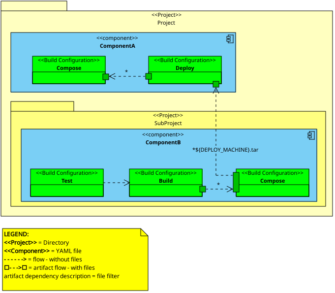

# Build chain example

This is an example of a build chain.
For the example purpose, this example reflects the build chain when this directory is set se `--config-dir`.

This example is not intended to be used for deployment.

`ComponentA` in `Project/SubProject` acts as theoretical Go module.
`ComponentB` in `Project` acts as theoretical deployment, which deploys ComponentA to a server on `DEPLOY_ADDRESS`.
The ComponentB can deploy multiple components, but this example shows only one for simplicity reasons.

## Diagram

This diagram shows the structure and dependency flow in this example.

